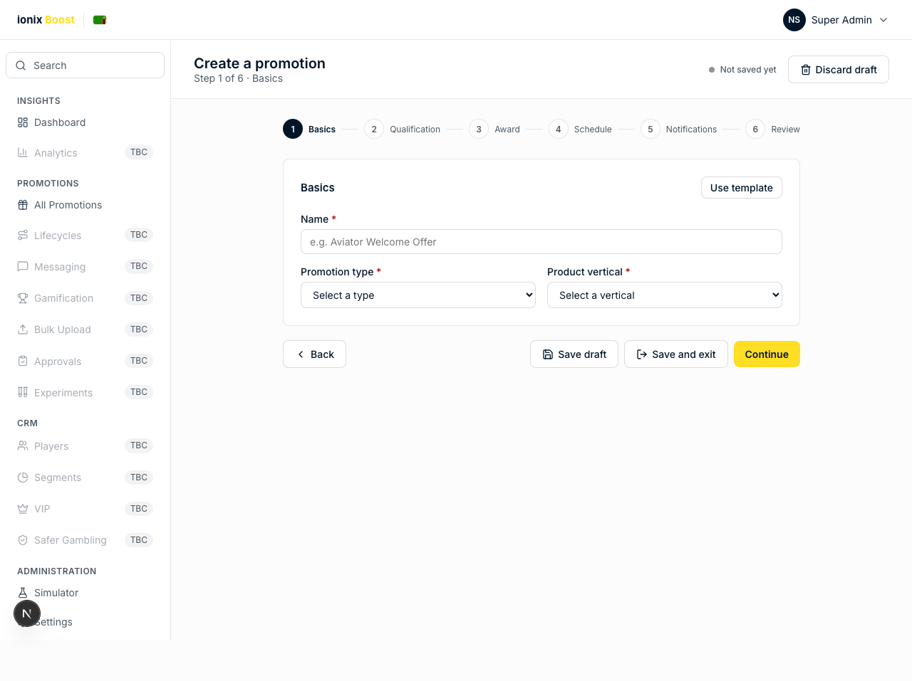
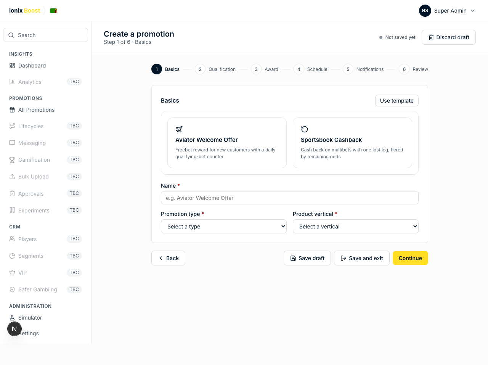
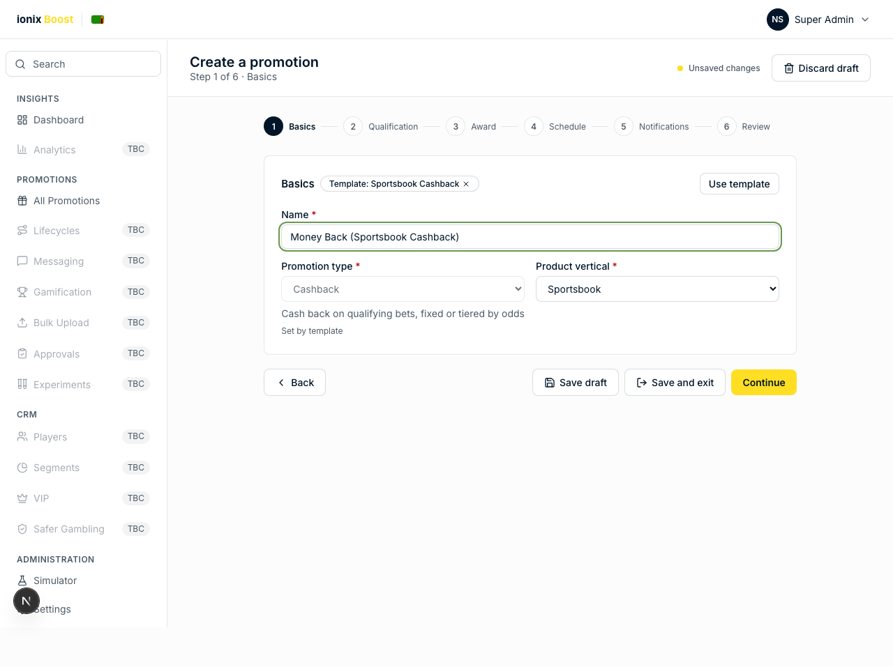
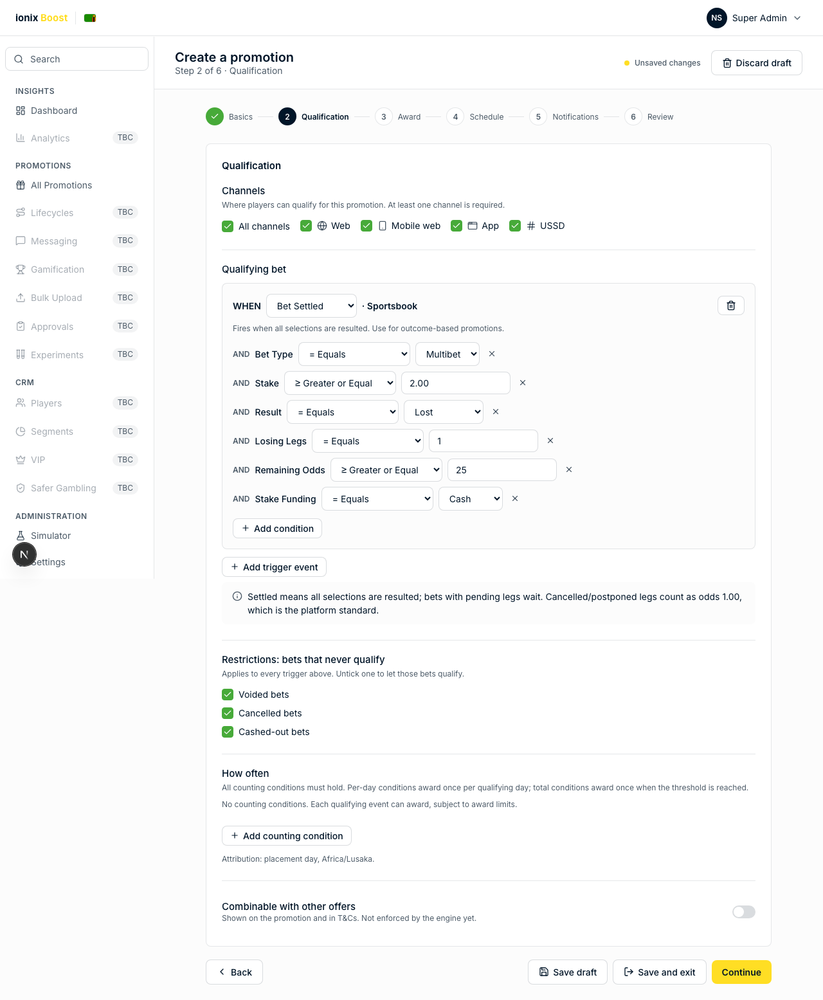
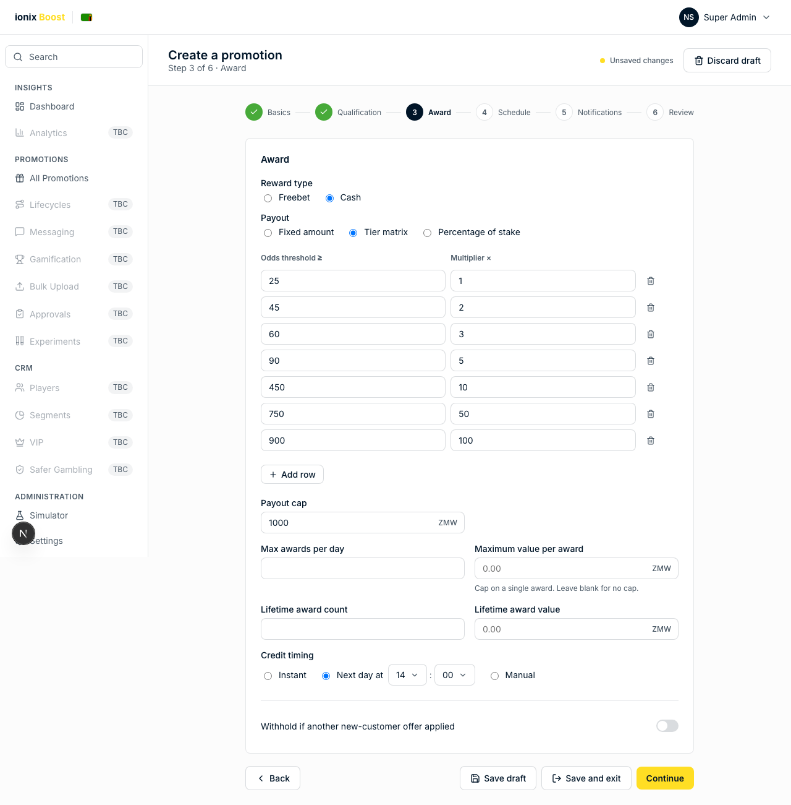
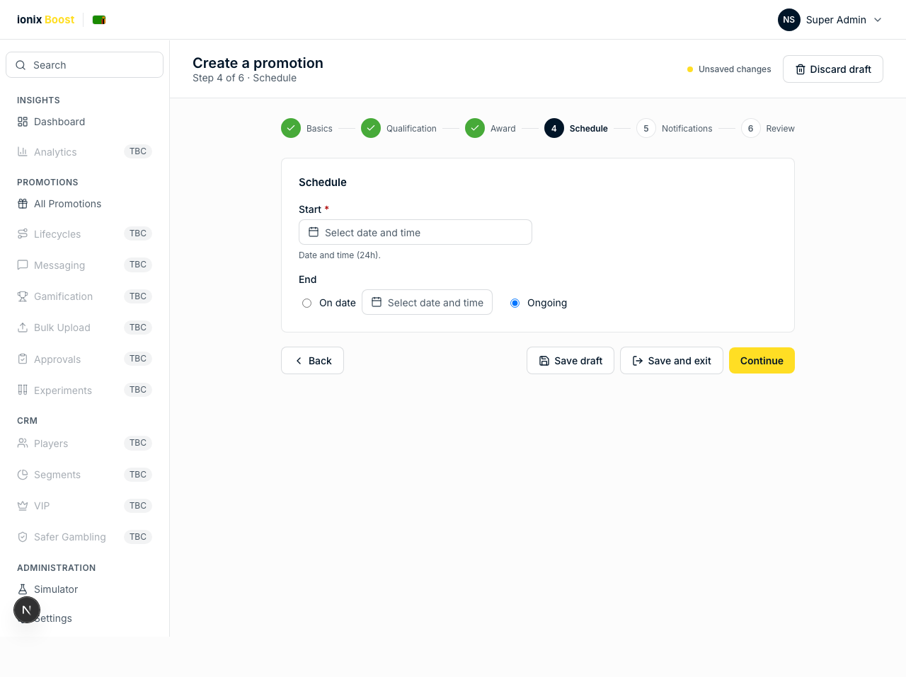
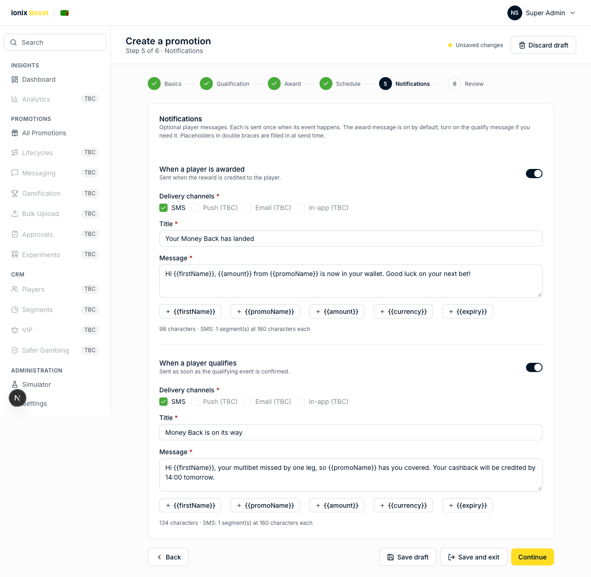
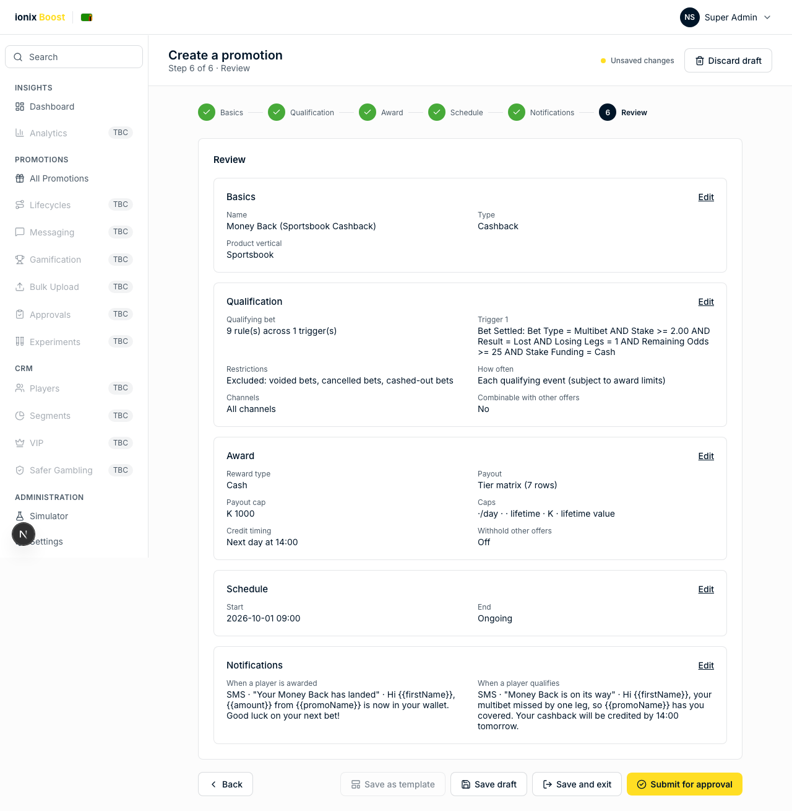
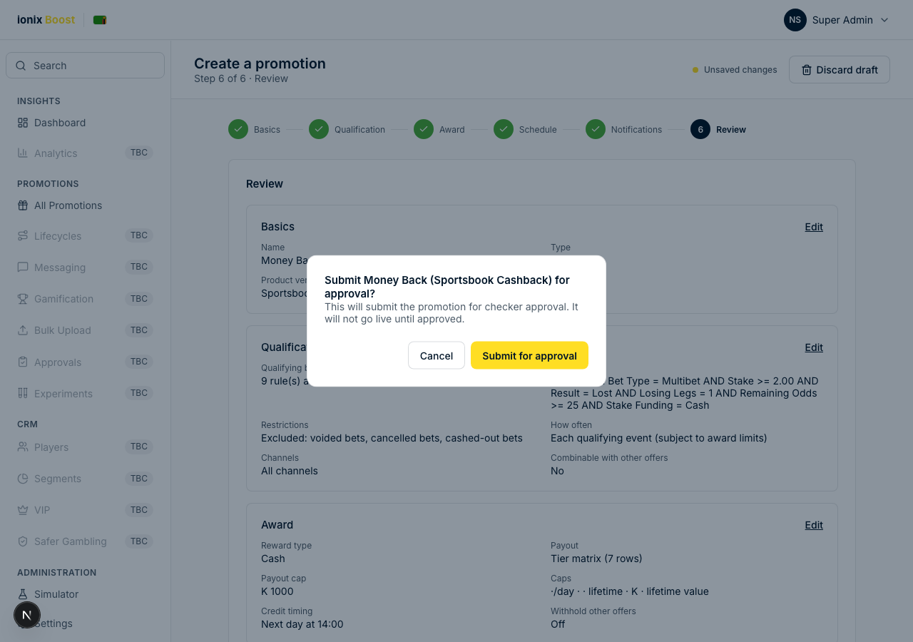

# Cashback promotion template: illustrated flow

This guide records the visible creation journey for the **Sportsbook Cashback** template in the admin prototype. It was captured at a 1280 × 900 desktop viewport with the demo feature flags in their current state.

## Flow at a glance

**Basics → Qualification → Award → Schedule → Notifications → Review → Submit for approval**

The demo has six visible steps. **Budget** and **Content** are feature-gated off, so there is no asset-upload or banner-placement screen in this flow.

## 1. Start a promotion

The blank Basics screen provides the promotion name, type, and product-vertical fields before a template is applied.

## 2. Choose the Sportsbook Cashback template

Select **Use template**, then select **Sportsbook Cashback** from the template panel.

## 3. Template defaults applied — Basics

Once attached, the template locks the promotion type to **Cashback**, selects the **Sportsbook** vertical, and displays the template chip. The promotion name may still be changed.

## 4. Qualification

The template qualifies settled Sportsbook multibets that meet all of these rules:

- Bet type: **Multibet**
- Stake: **at least 2.00**
- Result: **Lost**
- Losing legs: **1**
- Remaining odds: **at least 25**
- Stake funding: **Cash** (free-bet / bonus stakes do not qualify)

Voided bets, cancelled bets, and cashed-out bets are excluded. All channels are enabled by default. Target new customers with a Registration trigger or player-context conditions.

**Add trigger event** opens the event picker with an **AND / OR** switch (OR by default). OR means either event qualifies on its own; AND means the player must complete both. The join is shown on the divider between trigger cards and can be changed there later. AND binds tighter than OR, so `Bet Settled AND Deposit OR Registration` reads as "(Bet Settled and Deposit) or Registration".

## 5. Award

The template awards **cash** using a seven-row tier matrix. The displayed odds thresholds are 25, 45, 60, 90, 450, 750, and 900, with multipliers from 1× to 100×. It applies a **K 1,000** payout cap and schedules crediting for **14:00 the next day**.

## 6. Schedule

The Schedule step opens without a required start date and time. Enter these before continuing. The following captures show the initial state and an example ongoing schedule.

## 7. Notifications

The template enables notification messages for qualification and award, delivered by **SMS**. Push, Email and In-app are visible but disabled while those channels are TBC. The configured titles are **“Money Back is on its way”** and **“Your Money Back has landed.”**

## 8. Review

Review consolidates the five configured sections—Basics, Qualification, Award, Schedule, and Notifications—before submission. It does not contain a Content or asset section while the Content feature is disabled.

## 9. Submit for approval

**Submit for approval** opens a maker-checker confirmation dialog. Submission sends the promotion to a checker; it does not make the promotion live immediately.

## Image and banner assets

There are **no image or banner fields in the visible Cashback flow**, and this template does not prepopulate creative assets. Image placement belongs exclusively to the separate **Content** step (for example, desktop and mobile promotion-page banner slots). That step is currently hidden because `features.content` is `false`.

To include assets in the documented user journey, enable the Content feature and place the Content step after Schedule and before Notifications. Any required banner defaults must then be added to the Cashback template separately.

## Capture source and verification

The screenshots are generated by the Playwright regression test at [`frontend/tests/cashback-flow-screenshots.spec.ts`](../frontend/tests/cashback-flow-screenshots.spec.ts). The test confirms the Cashback template defaults, verifies the five review sections, captures every screen, and cancels the final dialog so it does not submit mock data.
